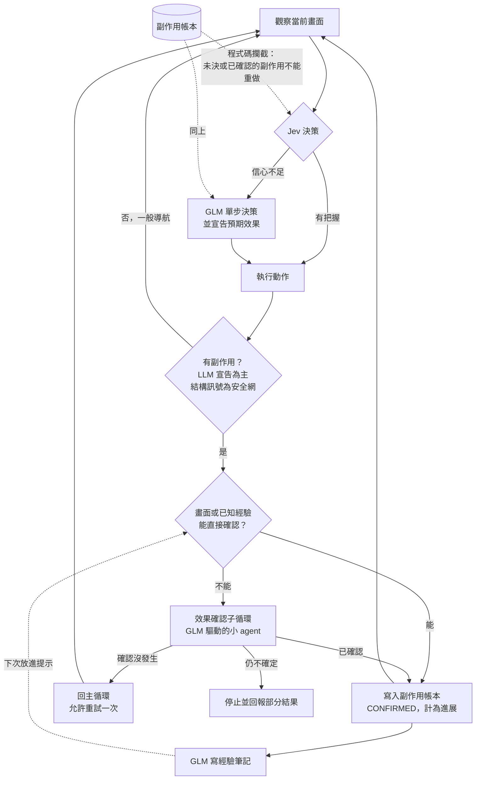
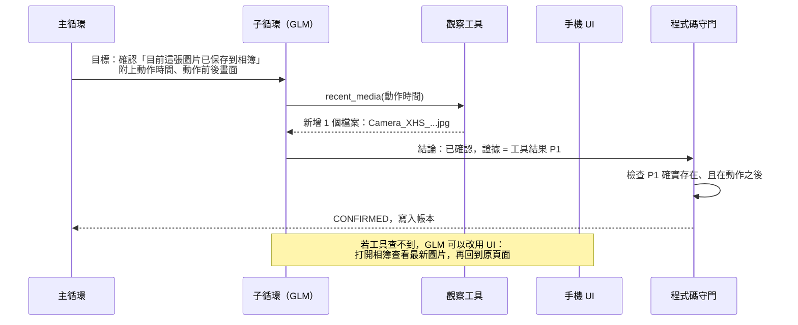
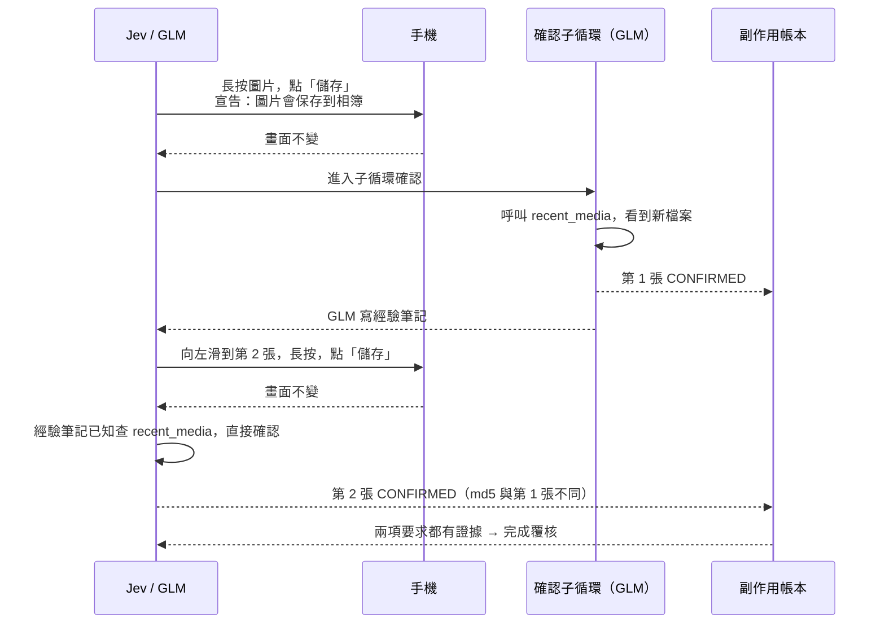

# 效果確認子循環（Effect Verification Loop）設計方案

> 狀態：P0–P4 已實作（見第 6、7 節），P5 未做。

## 1. 要解決的問題

Jev-first 的主循環把「畫面出現有根據的變化」當成進展。效果不在畫面上的操作（存圖、下載、送出後只閃一下提示）會被誤判為「沒有進展」，接著被重做，最後因重複而停止。

真機案例（小紅書存 2 張壁紙）：

| 現象 | 原因 |
| --- | --- |
| 同一張圖存了兩次（md5 相同） | 「儲存」成功後畫面不變，GLM 認為沒成功，再做一次 |
| 一直沒滑到第 2 張 | 卡在確認第 1 張 |
| 結果只回報「Repeated action without observable progress」 | 退出時沒有回報已完成的部分 |

兩個結構性問題：

1. **觀察只有快照**：分不清「沒有效果」和「有效果但看不到」。
2. **效果未知時允許重做**：重複偵測（`runtime.py` 的 `accept_fallback` 與 Jev 簽名檢查）容許同一動作出現第 2 次才擋，對有副作用的操作已經太晚。

## 2. 設計原則：LLM 決策，程式碼守底線、給能力

不為個別 App 或個別操作寫規則。分工如下：

| 事情 | 誰負責 | 說明 |
| --- | --- | --- |
| 動作有沒有副作用、預期效果是什麼 | **LLM** | 執行動作時一併宣告 `expected_effect` |
| 用什麼方法確認效果 | **LLM** | 從通用觀察工具中自己選，或導航到能看到結果的地方 |
| 子循環每一步做什麼 | **LLM** | 子循環是一個帶著驗證目標的小 agent |
| 效果是否發生的結論 | **LLM** | 必須引用證據 ID |
| 記下驗證經驗 | **LLM** | 寫成經驗筆記，下次放進提示 |
| 禁止重做未決的副作用、預算上限、子循環內只能做只讀動作 | 程式碼 | 安全底線，不交給模型 |
| 證據 ID 必須真實存在、且發生在動作之後 | 程式碼 | 防幻覺，沿用現有證據檢查 |
| 觀察工具本身（查媒體庫、通知、剪貼簿等） | 程式碼 | 提供的是**能力**，不是規則；用不用、怎麼用由 LLM 決定 |
| LLM 沒宣告時的安全網 | 程式碼 | 結構訊號只用來「保守地禁止重做」，不用來判定成功 |

快路徑不變：Jev 能確認的步驟照舊。慢路徑只在「做了但確認不了」時觸發。

### 2.1 知識分三層

「哪些動作通常有副作用」「效果通常在哪裡確認」這類判斷本身是有用的知識，問題只在放的位置：寫成程式碼規則就變成硬性判斷，換情況就失效。改成分三層存放：

| 層 | 內容 | 形式 | 誰維護 |
| --- | --- | --- | --- |
| 內建常識 | 通用的經驗法則，與 App 無關 | 系統提示詞檔案 | 開發者，隨版本更新 |
| App 經驗 | 某個 App 的具體做法 | 經驗筆記（4.7） | LLM 執行時累積 |
| 安全底線 | 禁止重做、預算、證據檢查 | 程式碼 | 開發者，很少變動 |

前兩層都是**給 LLM 參考的提示**，LLM 結合當下畫面自己判斷，可以不照做；只有第三層是強制的。

內建常識放在決策層既有的提示詞檔案 `mobilerun/agent/decision/android.md`（同時提供給 Jev 與 GLM），不改程式碼就能調整。實際寫入的是英文版，內容如下：

```text
關於動作的效果：
- 底部選單、對話框、彈出選單裡的按鈕，點了之後選單關閉、畫面回到原樣，
  通常代表一個已經完成的操作（保存、發送、收藏、刪除），而不是沒反應。
- 很多操作的結果不在當前畫面：保存的圖片和影片在相簿，下載的檔案在下載列表，
  發送的內容在已發送或聊天記錄，複製的內容在剪貼簿，提示訊息只會閃一下。
- 執行可能改變資料的動作前，先說出你預期會發生什麼，以及去哪裡能確認。
- 看不到效果時，先去能確認的地方查看，不要直接再做一次；
  重複保存、發送、下單會造成重複的結果。
- 確認不了時，如實說明已完成與未完成的部分。
```

寫成原則而非清單，控制在十行以內，避免提示詞膨脹。Jev 的提示（`jev.py` 的 `_RULES`）只加一句「可能改變資料的動作不要重複執行」，保持它的速度。

## 3. 整體架構



## 4. 元件

### 4.1 預期效果宣告（LLM）

GLM 每次回退決策，除了動作本身，多輸出一個欄位：

```json
{
  "action": "Tap",
  "index": 8,
  "expected_effect": {
    "side_effect": true,
    "description": "目前這張圖片會被保存到手機相簿",
    "visible_on_screen": false
  }
}
```

- 宣告的內容是自然語言，不是固定的類型清單，所以不限於存圖或下載。
- Jev 的決策只有操作類型，沒有這個欄位。Jev 選中的動作若結構訊號顯示可能有副作用（見 4.4），就請 GLM 補一次宣告；一般導航不需要。

### 4.2 通用觀察工具（程式碼提供能力，LLM 決定用法）

在子循環中開放給 GLM 的只讀工具：

| 工具 | 回傳 |
| --- | --- |
| `recent_media(since)` | 媒體庫中某時間點之後新增的圖片或影片：檔名、大小、md5 |
| `recent_downloads(since)` | 下載管理器中新增的項目 |
| `recent_notifications(since)` | 通知中心新增的通知標題與內容 |
| `clipboard()` | 剪貼簿目前內容 |
| `foreground()` | 前台 App 與畫面 |
| 一般 UI 操作 | 導航、滑動、返回、開 App，用來到能看到結果的地方查看 |

這些工具對應的是 Android 的系統服務，數量有限且與 App 無關。GLM 根據自己宣告的預期效果決定查哪一個。查不到時，它也可以像人一樣打開相簿、看已發送列表去確認。

### 4.3 效果確認子循環（LLM 驅動）

子循環是一個有明確目標的小 agent，每一步都由 GLM 決定：



GLM 在子循環中的職責：

1. 根據預期效果，選擇確認方法（呼叫觀察工具，或導航到能看到結果的地方）。
2. 看完結果，判斷「已確認、沒發生、仍不確定」。
3. 結論必須引用證據 ID（工具結果或畫面觀察）。
4. 結束前回到進入時的頁面；回不去就交還主循環，由 Jev 重新導航。

程式碼在子循環中只做三件事：

- **鎖定**：觸發子循環的那個副作用動作不能再次執行，子循環內其他有副作用的動作也一律拒絕。
- **預算**：最多 5 步或 120 秒（GLM 中轉單次約 10 秒），用完就是「仍不確定」。
- **證據檢查**：證據 ID 必須存在、且發生在該動作之後，沿用 `effect_order.py` 的 `has_post_action_result` 與 `bind_native_proofs`。

### 4.4 結構訊號（提示詞常識 + 程式碼安全網）

同一條知識用在兩個地方：在內建常識裡（2.1），它幫助 LLM 判斷；在程式碼裡，它只是安全網。

LLM 有時會忘記宣告，或 Jev 的動作沒有宣告。程式碼版本的結構訊號只用來**保守地禁止重做**，不用來判定成功或失敗：

- 點擊位於暫時性容器（底部選單、對話框、彈出選單）內的元素，且容器關閉後畫面回到開啟前的狀態。

符合時，該動作在帳本裡標記為「可能有副作用」，在確認前不能重做，並請 GLM 補宣告預期效果。這是確認型按鈕的通用外觀特徵，與按鈕文字和 App 無關。

### 4.5 副作用帳本（程式碼）

每個副作用動作一筆紀錄：簽名、預期效果描述、狀態（`PENDING`、`CONFIRMED`、`FAILED`、`UNVERIFIABLE`）與證據 ID。

- Jev 與 GLM 提出的動作，若簽名對應 `PENDING` 或 `CONFIRMED` 的副作用，直接拒絕。這比現有「同畫面同動作出現 2 次」的規則更早攔截。
- `FAILED`（確認沒發生）允許重試一次。
- `CONFIRMED` 計入 `SemanticProgress` 的有根據進展，避免誤觸發「沒有進展」的恢復。
- 完成覆核可以引用帳本作為持久化證據，接到 `persistent_results.py`。

### 4.6 部分結果回報

任何停止路徑都附上帳本摘要，由 GLM 根據帳本寫成給使用者看的說明，例如：

```
已確認：保存第 1 張壁紙（證據：媒體庫新增 Camera_XHS_...jpg）
未完成：保存第 2 張壁紙
停止原因：第 2 次保存的結果無法確認，為避免重複未再嘗試
```

### 4.7 經驗筆記（LLM 寫，程式碼存）

子循環成功確認後，GLM 寫一句經驗筆記，例如「小紅書：長按圖片 → 選單『儲存』，結果查 `recent_media` 即可確認」。程式碼按 App 存起來（沿用 app cards 機制），下次同一個 App 放進提示。下次遇到同類動作，GLM 在主循環就能直接用對的方法確認，不必進子循環。

筆記是給 LLM 看的提示，不是程式碼執行的規則；App 改版導致筆記失效時，LLM 會發現確認不了，自然退回子循環。

## 5. 小紅書案例：改造前後



改造前：第 1 張存完被判定沒進展 → 重做 → 重複存同一張 → 停止，不回報任何部分結果。

## 6. 接入點

實際實作（子循環沒有另開模組，而是主循環在有待確認副作用時進入「確認模式」，重用現有的 GLM 單步決策）：

| 位置 | 改動 |
| --- | --- |
| `mobilerun/agent/decision/effects.py`（新增） | 副作用帳本、穩定的動作識別（App + 工具 + 目標文字）、結構訊號、證據時序檢查、預算、經驗筆記存取 |
| `decision/runtime.py` `record_execution` / `track_effect` | 記錄 GLM 宣告的副作用與結構訊號軌跡 |
| `decision/runtime.py` `select()` | 先偵測結構訊號；有待確認的副作用時先進確認模式（`_verify_effect`），再進 Jev |
| `decision/runtime.py` `_visual` | 確認模式下只開放導航與 `recent_media`，加入 `Verify`；拒絕重做被確認的動作 |
| `decision/runtime.py` `resolve_effect` | 處理結論：已確認（計為進展、清空重複偵測、存經驗筆記）、沒發生（允許重試一次）、仍不確定（停止） |
| `decision/runtime.py` `recent_media` | 透過 ADB 查媒體庫在動作之後新增的圖片與影片，附 md5 |
| `decision/runtime.py` Jev 分支、`accept_fallback` | Jev 遇到已確認副作用的同一目標時交給 GLM 判斷；未確認的副作用不能重做 |
| `decision/runtime.py` `task_context` / `load_guidance` | 帳本放進 `ledger.side_effects`；經驗筆記附在 App 提示後 |
| `decision/visual_fallback.py` | 解析 `effect` 欄位、`Verify` 與 `Recent_media` 動作；提示詞加入說明 |
| `decision/android.md` | 內建常識 |
| `decision/jev.py` `_RULES` | 加一句「不要重複已確認或未確認的改變資料動作」 |
| `fast_agent/fast_agent.py` `finalize` | 所有失敗的停止路徑附上帳本摘要 |
| `tests/test_effect_verification.py`（新增） | 25 個離線測試 |

經驗筆記存在 `platformdirs.user_data_dir("mobilerun")/effect_notes.json`（Windows 為 `%LOCALAPPDATA%\mobilerun\mobilerun\effect_notes.json`），每個 App 最多 5 條。

### 真機驗收後新增的兩個機制

1. **確認開始時自動查媒體庫**（`_verify_effect`）：GLM 在確認時常只看畫面，而畫面看不出存圖結果，曾把已存成功誤判為「沒發生」而重存。現在確認第一步由程式先跑一次 `recent_media`，結果以 P 編號放進 GLM 的上下文並可作為證據。
2. **每次點擊後自動比對媒體庫**（`observe_media_effect`）：Jev 不宣告預期效果，結構訊號也可能因畫面上殘留提示而失效，曾有一次保存沒被記錄。現在任何點擊之後，程式都查一次媒體庫（一次 ADB 查詢，不呼叫 LLM）；有新檔案就直接記成已確認的副作用。兩個機制都用 md5 標記同一任務內的重複保存（`DUPLICATE of ...`），提示 GLM 換下一個對象。

### 實作中新增的規則：確認後清空重複偵測

圖片內容不在 UI 樹裡，同一帖子不同圖片的頁面 UI 樹指紋相同；現有的重複偵測會把存第 2 張時的長按與「儲存」當成重複動作擋掉。因此副作用一旦確認，就清空重複偵測歷史：確認了真實效果就是進展，之前的重複紀錄不再代表卡住。兩次確認之間，防無限迴圈的保護照樣有效。

另一個相關發現：GLM 動作原本用截圖雜湊當簽名的一部分，狀態列時間每分鐘變一次，使同一動作被當成不同動作而放行（這是第一次真機失敗時同一張圖被存兩次的原因）。帳本改用目標文字識別動作，不受狀態列影響。

## 7. 分階段實作

| 階段 | 內容 | 狀態 |
| --- | --- | --- |
| P0 保底 | 副作用帳本、結構訊號安全網、禁止重做、部分結果回報 | 已實作 |
| P1 內建常識與預期效果宣告 | `android.md`；GLM 輸出 `effect`；Jev 動作靠結構訊號 | 已實作（Jev 不補宣告） |
| P2 確認子循環 | GLM 驅動，導航 + 觀察工具 | 已實作 |
| P3 通用觀察工具 | 目前只有媒體庫（`recent_media`）；下載、通知、剪貼簿未做 | 部分 |
| P4 經驗筆記 | GLM 寫、程式碼存，下次放進提示 | 已實作 |
| P5 事件流 | Portal 轉發無障礙事件（Toast 等），另一個 repo | 未做 |

## 8. 驗收

- **小紅書存 2 張**：相簿新增 2 個 md5 不同的檔案，沒有重複，任務判定成功。
- **查看語言（回歸）**：耗時與模型呼叫次數不高於目前（約 75 秒、9 次），快路徑沒有被拖慢。
- **故意製造確認不了的情況**：不重做，停止時回報已完成與未完成的項目。
- **離線測試**：鎖定、預算、證據檢查、帳本攔截各有單元測試；子循環的 GLM 輸出用錄好的回應做測試。

## 9. 已採用的預設值

1. 子循環預算：5 步或 120 秒（`effects.py` 的 `VERIFY_STEP_BUDGET`、`VERIFY_SECONDS_BUDGET`）。原定 45 秒在真機上不夠 GLM 呼叫 4 次。
2. 確認「沒發生」後允許重試 1 次（`RETRY_AFTER_NOT_HAPPENED`）。
3. 經驗筆記存在獨立的本機檔案，不改 app cards 格式。
4. Portal（P5）暫不修改。
5. `Verify` 的結論一律套用到當前待確認的副作用，`id` 選填；只有明確引用其他副作用 ID 時才拒絕（真機上 GLM 會把描述填進 ID 欄位）。

## 10. 已知限制

- 每個副作用動作可能多一次 GLM 呼叫（宣告或子循環）；經驗筆記累積後會減少。
- App 自己畫的提示不走系統 Toast，事件流抓不到，只能靠子循環。
- 觀察工具證明「有東西變了」，不證明是「對的東西」，例如存到的是不是使用者要的那張圖。語意歸屬由 GLM 結論與完成覆核負責。
- LLM 的結論可能出錯；程式碼只能檢查證據存在且時間正確，不能檢查 LLM 對證據的解讀是否正確。
