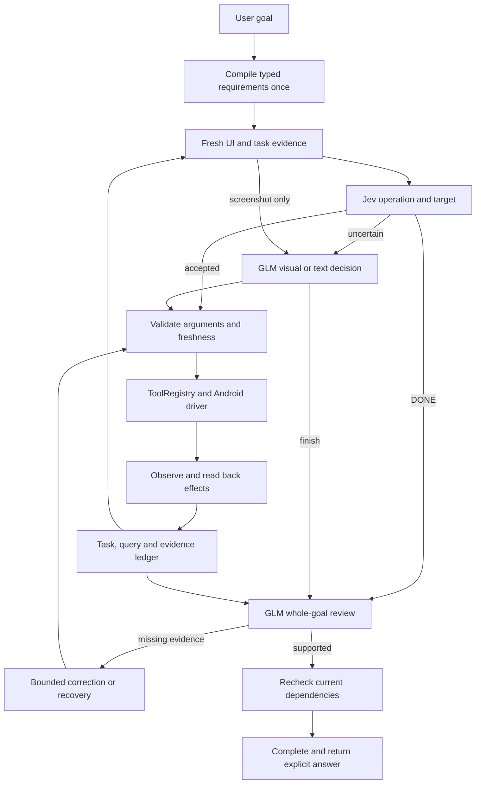

# Jev-first Android Agent

The agent extends the existing Mobilerun runtime. An accepted Jev decision uses an existing tool directly. GLM handles missing text arguments, visual targets, bounded recovery and full-goal completion review. Screenshot-only pages use the visual adapter.

See [the optimization guide](../OPTIMIZATION.md) for setup, the CLI command, implemented capabilities and validation limits. The everyday entry point is `examples/jev_phone.py --goal ...`; final-state assertions and text candidates are optional.

Configuration is opt-in with `agent.reasoning: false` and `agent.jev.enabled: true`. `fallback: autoglm` selects the dedicated phone-action/review adapter. `fallback: llm` retains the ordinary FastAgent model fallback. The example enables the Jev-first phone adapter. Provider URL, dedicated credential variable, action model and reasoning model are configurable independently.

The selected defaults are `glm-5.3-flash`, thinking disabled, an OpenAI-compatible relay URL and a 45-second visual request deadline. Jev credentials come from `TYPESAFE_API_KEY`; relay credentials come from `GLM_API_KEY`. No credentials are embedded in this branch.

Native labels, affordances, parent relationships, field values and viewport boundaries retain actual observation references. A tool returning success proves dispatch; requirements need observed effects. Query answers False, zero or an empty collection can be successful when scope and coverage are supported. Saving and final location have separate evidence requirements.

Screenshots are cached only when actually captured, within the existing eight-image/16-MiB cache; reviews upload at most three distinct images with matching hashes. Historical hashes without uploaded pixels are insufficient. Different empty-native frames retain separate observation epochs and bounded history groups; matching pixels do not establish business identity. Current-image dependencies are checked again before completion.

The code-only delivery passed 1310 selected offline Agent behavior/regression checks and CLI/import/lint validation. Real-device scoring, latency and unfamiliar-App generalization remain deferred; offline checks do not establish these outcomes.
